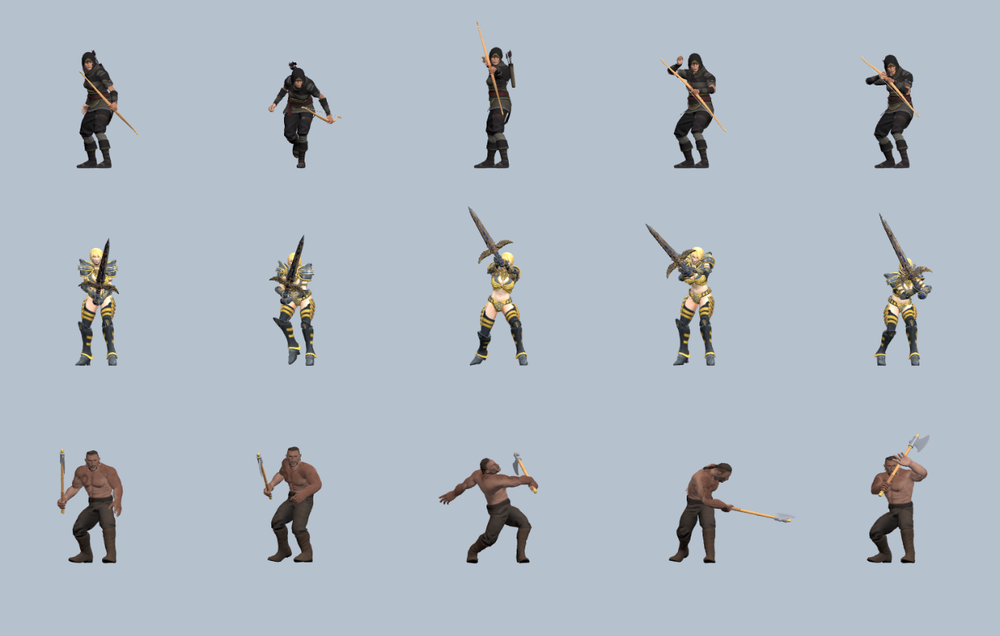

# Weapon geometry fitting — 2026-10-16

This follow-up corrects visible errors reported in Archer, Great Sword and Axe previews. The earlier palm-origin checks did not prove that the visible handle was inside the hand.

## Changes

- Each weapon has an explicit handle center measured on its source geometry after axis conversion. Bow limbs and axe heads make the overall bounding-box center unsuitable as a socket. The previous bow and axe fits displaced the visible handle by roughly 7–9 cm.
- The hand socket now sits between the thumb and curled middle finger. It follows the native animation's grip instead of placing the weapon against the back of the palm.
- Sword +Y points from the lower supporting hand toward the upper dominant hand, so the blade extends away from the supporting hand. Two-hand guidance preserves that direction during movement.
- Bow and axe mounting frames include roll and use the axis across the knuckles. The bow no longer starts with an arbitrary vertical world rotation.
- The Kenney rifle source barrel faces -Z. It is rotated into the game's +Z convention, its pistol grip is centered on the hand, and its muzzle marker follows the corrected geometry.
- Lengths: bow 1.45 m, sword 1.45 m, axe 1.15 m; rifle remains 0.85 m.

Edit the `WEAPONS` table in `src/characters/FighterWeapons.js` to change asset dimensions or measured handle coordinates. `src/characters/HandSocket.js` defines the finger grip center. Handle coordinates are in source units after axis conversion; lengths are world meters.

## Verification

- `npm test`: 54 passing tests.
- `weapon-fit-playtest.js`: 840 native pose samples across four equipped fighters; all checks pass. Tests intersect actual handle triangles through the socket, check grip distance from fingers, verify hand-relative rotation, and verify sword direction.
- `roster-playtest.js`: all existing attacks and roster checks pass.
- Visually reviewed lobby previews for Archer, Great Sword, Axe and Soldier, plus the contact sheet below. Columns: Idle, Run, Light, Heavy, Block. Rows: Archer, Great Sword, Axe. These are sampled poses; finger meshes and glove shapes can still clip slightly around a rigid prop during individual frames.

